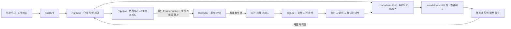

# 카메라 기반 사용자 물체 학습 · 최종 구현 설계

갱신: 2026-11-06 (KST). 초기 제안서를 확정된 구현에 맞게 갱신했다. 실제 수행 결과와 남은 실장비 검증은 [학습 검증 보고서](custom-object-training-validation.md)를 참고한다.

## 1. 사용자 흐름과 범위

**클래스·촬영 환경·수집 모델 선택 → 중앙 물체 촬영 → 승인/제외 → 데이터셋 고정 → MPS 학습·평가 → Core ML 변환·비교 → 모델 버전 적용**을 제공한다. FastAPI, Ultralytics, SQLite, HTML/CSS/JavaScript를 사용하며 Label Studio와 BentoML은 도입하지 않는다. [오픈소스 활용 비교](opensource-vs-custom-comparison.md)는 별도로 유지한다.

- 서버 시작 시 카메라를 자동 시작한다. 브라우저를 닫아도 카메라는 유지된다.
- 사진 수집은 사용자가 시작해야 하며, 미검출 물체는 촬영하지 않는다.
- 사진 저장 중지와 카메라 끄기는 별도 동작이다. 검토 화면으로 이동하거나 저장을 멈춰도 카메라 자동 시작 정책은 유지한다.
- 학습·평가·변환 중 카메라와 실시간 추론을 해제한다. 종료 후 이전 모델로 탐지를 재개한다. 사진 수집과 새 모델 적용은 자동 재개하지 않는다.
- 사용자가 카메라를 끄거나 서버를 종료하면 작업 후 탐지 자동 재개를 취소한다.
- 사용자 클래스 전용 모델을 만든다. COCO80 원본 모델은 보존한다. 수동 박스 수정, 미검출 대상 수동 촬영, COCO80 통합 학습은 지원하지 않는다.

기존 모델이 `bottle`로 탐지하는 특정 병을 `내 보온병`으로 수집할 수 있다. 이름을 입력하는 것만으로 기존 탐지기가 새로운 물체를 발견하지는 않는다. 자동 박스는 검토가 필요한 라벨 초안이며 실물의 신원을 보장하지 않는다.

## 2. 실행 구조와 소유권



| 코드 | 책임 |
| --- | --- |
| `app/runtime.py` | 실행 잠금, 카메라 정책, 모델 교체·복구, 단일 작업, 소유 프로세스 정리 |
| `app/store.py` | SQLite WAL/FULL 동기화, JSON 메타데이터 레코드, 복구, 원자적 파일 기록 |
| `app/collection.py` | 중앙 후보, 연속성, 간격·최신성, 저장 큐, lease, 중지 barrier |
| `app/datasets.py` | 승인 샘플 선택, 그룹·중복 연결, 클래스 매핑, 파일 복제·검증 |
| `scripts/training_worker.py` | 고정 MPS 학습, 콜백, 평가, Core ML, 부모 EOF 감시 |
| `app/training_api.py` | 수집·검토·작업·모델 API와 `/ws/events` |
| `app/static/training.js` | 수집·검토·작업·버전 UI. 사용자 입력은 textContent로 표시 |

Uvicorn worker는 **1개**만 실행한다. 카메라와 추론 모델은 각각 한 작업자가 소유한다. 상태 조회는 모델 로드와 분리되며 로드·워밍업은 HTTP 이벤트 루프를 막지 않는다. 실행 잠금은 같은 서버의 여러 브라우저 요청에도 적용된다. 동시에 두 네이티브 서버를 실행하는 구성은 지원하지 않는다.

## 3. 촬영과 저장

| 항목 | 동작 |
| --- | --- |
| 기본값 | 250ms, confidence 0.50, 중앙 가로·세로 40% |
| 설정 범위 | 100~2,000ms, confidence 0.01~0.99. 수집 confidence는 서버 탐지 임계값 이상 |
| 후보 | 박스 중심이 중앙 40% 안에 있고 박스가 화면 중앙점을 포함 |
| 안정화 | 서로 다른 처리 프레임 3개, 같은 원래 클래스, 이전 박스 IoU ≥ 0.5, 프레임 간격 ≤ 500ms |
| 대기 | 미검출, 중앙 이탈, 복수 후보, 낮은 confidence, 잘못된 좌표, 오래된 결과 |
| 중복 방지 | 세션별 단조 증가 frame_id 검사. 모델 전환은 새 session_id 발급 |
| 최신성 | enqueue 및 writer 시작 시 캡처 후 500ms 이내 |
| 큐 | 최대 8개. 포화 시 신규 요청만 생략하고 사유 집계 |
| 원본 | 추론에 사용한 전체 원본 프레임, JPEG 품질 95. 박스를 그린 미리보기는 저장하지 않음 |
| 라벨 | 클래스 ID 0, YOLO 정규화 xywh. 실제 클래스 UUID는 SQLite 메타데이터 |
| 표시 | 실시간 영상에서 수집 후보는 노란 박스. 서버가 동일 프레임에 그림 |
| heartbeat | 시작한 탭이 3초마다 전송. 10초 만료 시 사진 저장만 중지 |

박스는 이미지 경계로 제한한다. 비유한 수치와 면적 0 이하 박스는 거부한다. 정규화는 `((x1+x2)/2/W, (y1+y2)/2/H, (x2-x1)/W, (y2-y1)/H)`를 사용한다.

클래스·환경은 UUID를 경로로 사용하며 한글 이름을 허용한다. 같은 이름은 기존 항목을 선택하도록 안내한다. 환경 그룹은 명시적으로 등록·재사용한다. 같은 장소에서 중지·재시작한 세션을 독립 환경으로 자동 취급하지 않는다.

이미지·라벨을 각각 임시 파일에 기록하고 fsync/rename 후 DB에 완료 샘플을 등록한다. 두 파일을 동시에 원자적으로 rename한다고 가정하지 않는다. 실패한 쌍은 정리하며 완료·승인 레코드만 학습에 사용한다. 재시작은 저장소가 소유하는 `sample-UUID` 형식의 불완전 파일만 정리한다.

중지는 신규 enqueue를 막고 큐를 비운다. 진행 중 쓰기가 끝난 뒤 `stopped`와 최종 장수를 반환한다. 큐 항목에는 수집 실행 토큰이 있어 같은 세션을 다시 시작해도 이전 요청이 섞이지 않는다. 디스크 또는 DB 오류는 저장을 멈추고 상태에 노출한다.

쓰기를 마무리하는 동안 `stopping`을 표시하고 재시작을 거부한다. 상태 DB 기록 실패도 쓰기·카메라 정리를 건너뛰지 않는다. UI의 준비 중 중지는 이후 시작 단계를 취소하며, 이미 보낸 시작 요청은 응답 후 중지까지 마친 뒤 완료를 표시한다. 중지 요청 시 heartbeat도 해제하므로 HTTP 실패가 발생해도 수집 유지 신호를 계속 갱신하지 않는다.

## 4. 검토와 고정 데이터셋

검토 화면은 썸네일·원본 자동 박스·원래 confidence·유사 묶음을 표시한다. 개별 및 선택 일괄 승인/제외를 제공하며 박스 편집이나 자동 삭제는 하지 않는다. 다른 대상이 함께 있지만 라벨이 누락된 사진, 부분만 감싼 박스, 잘린 대상은 제외한다.

데이터셋 생성은 누적 승인 자료의 모든 클래스를 UUID 순으로 정수 ID에 매핑한다. 같은 환경 그룹, 동일 SHA-256, dHash Hamming 거리 6 이하인 사진을 연결 요소로 묶어 같은 split에 배치한다. dHash는 유사도 휴리스틱이며 모든 의미적 중복을 검출하지는 못한다. 장면을 정확히 그룹화하는 사용자의 역할이 중요하다.

연결 요소 단위로 train/validation 약 80:20에 가까운 조합을 고른다. 각 클래스가 양쪽에 없으면 실패하고 추가 촬영을 안내한다. 17개 이하 그룹에서는 전체 조합을 탐색한다. 18개 이상에서는 seed 42로 양쪽 클래스 포함을 우선하는 구성을 최대 256회 시도하고, 비율을 개선한 후보와 최대 10,000개 무작위 후보를 추가 검사한다. 목표 비율을 정확히 만족하면 탐색을 끝낸다. 큰 그룹의 탐색은 유한 횟수 휴리스틱이므로 모든 유효 분할을 찾는 보장은 없다. 유효 조합을 찾지 못하면 사진 단위 무작위 분할로 대체하지 않는다. 클래스당 300~500장·독립 환경 3개 이상은 수집 권장치이며 품질 보장이 아니다.

단일 촬영 환경의 승인 자료는 독립 분할 없이 저장할 수 있다. 생성 API는 HTTP 201과 `status: "awaiting_validation"`을 반환하고 모든 승인 이미지·라벨을 train에 복제하며 val 목록은 비워 둔다. 학습 작업·평가·모델 생성에는 독립 검증 자료가 필요하므로 이 버전은 학습 API에서 422로 거부한다. 다른 환경 자료를 추가 승인한 뒤 다시 고정하면 기존 버전과 별개의 데이터셋을 생성한다.

여러 촬영 환경의 경우에는 기존 그룹 분할 정책을 적용한다. 유효 분할은 `status: "ready"`로 저장한다. 분할 실패 응답은 HTTP 422와 문자열 `detail`을 유지한다. 승인 사진 수·촬영 환경 수·독립 그룹 수 및 부족한 클래스와 환경 이름을 안내한다. 등록만 한 환경이나 검토 대기·제외 사진은 세지 않는다. 상태 필드 도입 전 만든 데이터셋도 train과 val 장수가 양수이면 종전처럼 사용할 수 있다.

고정 파일은 원본의 복사본이다. 하드 링크를 사용하지 않는다. 이미지·라벨·클래스 매핑·split·환경 그룹·해시를 `manifest.json`에 기록한다. `train.txt`, `val.txt`의 **명시적인 이미지 목록**으로 학습하므로 폴더에 나중에 추가된 사진이 섞이지 않는다. YAML·목록·이미지·라벨 해시를 학습과 변환 전에 검사한다. 이후 검토 상태 변경은 기존 스냅샷을 바꾸지 않는다.

## 5. 학습·평가·Core ML

| 설정 | 기본값 |
| --- | --- |
| 장치·입력 | MPS · 640 × 640 |
| batch / epochs / patience | 4 / 50 / 10. UI에서 변경 가능 |
| workers / cache | 0 / False |
| seed / deterministic | 42 / True |
| AMP / optimizer | False / AdamW |
| close_mosaic | 0. 짧은 실행에서도 자동 epoch 변경 없이 고정 |
| 초기 모델 | 준비된 로컬 YOLOv8n.pt 또는 클래스 UUID·이름·순서가 동일한 이전 사용자 PT |

`.conda/train`은 별도 conda 환경이며 Ultralytics 8.4.202를 고정한다. 다른 버전은 학습 제어 호환성을 확인하기 전 실행을 거부한다. 해당 버전의 첫 epoch OOM batch 축소를 콜백 guard로 비활성화하고 실제 batch 값도 검사한다. OOM, 비유한 loss는 실패한다. CPU fallback은 끄며 사용자가 batch 2/1 등으로 새 작업을 요청해야 한다. 마지막 작은 미니배치와 검증 배치는 라이브러리의 일반 동작이며 요청한 학습 batch를 변경하는 재시도와 구분한다.

오프라인 모드와 로컬 가중치 해시를 사용한다. plots=False인 학습에서는 Unicode plot font 자동 다운로드를 건너뛴다. JPEG의 한글 클래스명은 macOS 시스템 글꼴을 사용한다.

`queued → preparing → training → evaluating → exporting → completed` 순서이며 `failed`, `cancelled`, `interrupted`, `completed_with_warnings`를 별도로 제공한다. 콜백이 epoch·loss·평가 지표·실제 batch를 JSON으로 기록한다. stdout/stderr 로그도 조회할 수 있다.

PT 등록 전 로드·워밍업, 클래스 매핑, 검증 이미지 출력의 유한성·원본 좌표를 확인한다. 평가는 해당 사용자 스냅샷의 validation으로 수행한다. 두 형식 모두 confidence 0.001, IoU 0.45, max_det 100, rect=False이다. mAP50–95/mAP50, 클래스별 AP/recall, confidence 0.25·IoU 0.50의 precision/recall와 누락·오탐 이미지 예시를 기록한다. 서비스 지연은 confidence 0.25, 동일 validation 순서, 10회 워밍업·50회 반복으로 별도 측정한다. 기존 COCO128 50회/1,000회 벤치마크와 혼합하지 않는다.

Core ML은 같은 `best.pt`에서 정적 640·batch 1·FP16·raw 출력으로 변환한다. 설치 버전의 `quantize=16`을 사용하며 NMS 기본 raw 출력을 실제 shape로 검사한다. `Detector`의 공통 LetterBox/NMS/scale_boxes와 `CPU_AND_NE`를 사용한다. 전체 Neural Engine 실행을 주장하지 않는다.

- PT 기술 검증 실패 또는 작업 취소: 사용 가능한 신규 버전 없음.
- Core ML 오류 또는 mAP50–95 감소 > 1%p: PT 유지, Core ML 선택 불가, 원인 기록.
- 두 형식 통과: 형식별 ready 등록. 실사용 정확도 인증을 뜻하지 않음.
- 새 모델은 자동 활성화하지 않음.

완료 파일과 모델 메타데이터를 기록한 다음 모델·완료 작업 레코드를 하나의 SQLite 트랜잭션으로 공개한다. 취소는 PT 검증 이후라도 신규 버전을 등록하지 않는다.

## 6. 프로세스 수명과 모델 전환

작업당 별도 프로세스 그룹을 생성한다. 취소는 SIGTERM, 4초 후 SIGKILL과 reap을 수행한다. 자식은 부모가 소유한 파이프의 EOF를 감시하여 부모의 비정상 종료 시 자신의 그룹을 종료한다. 서버 종료는 사진·카메라·자식 작업을 정리한다. 통합 종료 스크립트도 확인된 서버의 학습 자손만 추가 정리하며 무관한 Python 프로세스를 종료하지 않는다.

재시작 시 실행 중 레코드는 `interrupted`로 복구하고 자동 실행하지 않는다. 초기 카메라 자동 시작 정책은 유지되지만 수집은 재개하지 않는다.

모델 적용은 202 operation을 반환한다. 현재 백엔드용 ready 형식·파일·해시를 확인한 뒤 기존 파이프라인을 종료한다. 새 모델 로드·워밍업에 실패하면 이전 모델을 복구한다. 작업자가 종료되지 않으면 두 카메라/모델을 동시에 실행하지 않고 오류로 중단한다. 전환 중 readiness는 503이며 이전 결과·JPEG를 내보내지 않는다.

모델 전환은 새 session_id를 발급한다. WebSocket/MJPEG는 Runtime을 참조하여 새 파이프라인을 따라간다. 중복 키는 `(session_id, frame_id)`, MJPEG 헤더는 `X-Session-Id`, `X-Frame-Id`, `X-Model-Version`이다. 활성 모델은 백엔드별로 기억하며 명시적인 `YOLO_MODEL_PATH`가 시작 시 우선한다.

## 7. API

| 메서드·경로 | 기능 |
| --- | --- |
| GET/POST `/api/classes` | 클래스 조회·등록 |
| GET/POST `/api/capture-groups` | 재사용할 촬영 환경 그룹 |
| GET/POST `/api/collections`, GET `/{id}` | 수집 세션·설정·저장 수 |
| POST `/api/collections/{id}/start`, `/stop`, `/heartbeat` | 수집 제어 |
| GET `/api/collections/{id}/samples` | 검토 상태·박스·유사 묶음 |
| GET `/api/samples/{id}/image`, `/thumbnail` | 원본 또는 축소 JPEG |
| PATCH `/api/samples/{id}` | `review: pending/approved/excluded` |
| POST `/api/samples/review` | `{ids: [...], review: ...}` 일괄 검토 |
| GET/POST `/api/datasets`, GET `/{id}` | 고정 스냅샷 |
| GET/POST `/api/training/jobs`, GET `/{id}` | 작업 생성·목록·상태 |
| POST `/api/training/jobs/{id}/cancel`, GET `/{id}/log` | 취소·로그 |
| GET `/api/models`, POST `/{id}/activate` | 형식별 목록·적용 |
| POST `/api/camera/start`, `/api/camera/stop` | 카메라 명시적 제어 |
| GET `/api/operations/{id}` | 모델 적용 상태 |
| WS `/ws/events` | 현재 수집·작업·모델·operation snapshot, 1초마다 |

작업 및 모델 적용은 202, 생성은 201, 입력 오류는 422, 항목 없음은 404, 실행 충돌은 409를 사용한다. 기존 탐지 API는 유지한다. `/ws/events`는 클라이언트마다 누적 큐를 만들지 않고 최신 상태를 보내며 5초 전송 제한을 적용한다. 상세 스키마는 서버 `/docs`에서 확인한다.

## 8. 파일과 환경

```text
.conda/{mps,coreml,train}/       # 독립 conda 환경
models/yolov8n.{pt,mlpackage}   # 원본 수집·초기 모델
data/coco128/                  # 기존 비교·기능 검증용 공개 자료
state/                        # YOLO_STATE_DIR로 변경 가능, 기본 Git 제외
  metadata.sqlite3            # WAL/SHM 포함 백업 필요
  collections/<collection>/   # 원본 jpg + local class 0 txt
  datasets/<dataset>/         # 복제 이미지/라벨, train.txt/val.txt, YAML, manifest
  jobs/<job>/                 # request/progress/log/pt-result/coreml-result/model.json
    run/weights/best.pt       # 검증된 사용자 모델
    run/weights/best.mlpackage/
artifacts/training-smoke-*/    # 기능 검증 자료, 실제 사용자 데이터와 분리
```

백업 시 서버를 종료한 뒤 `state/` 전체를 함께 복사한다. 내부 manifest/YAML은 절대 경로를 포함하므로 폴더를 다른 위치로 이동하는 기능은 제공하지 않는다. `YOLO_STATE_DIR`를 별도 위치로 설정할 때에도 그 위치를 Git에 추가하지 않는다. Docker는 중계만 담당하며 사진·DB·학습 환경은 이미지에 포함하지 않는다.

## 9. 검증 범위

자동 테스트는 후보/중복/간격/소실·재획득, 큐 포화, 원본·좌표, 디스크/DB 오류, 중지 경합, lease 만료, 승인·분할·스냅샷, 작업 충돌·취소·복구, 부모 EOF·소유 자식 정리, 모델 전환·복구·다중 클라이언트, Core ML 정확도 gate를 다룬다. 실제 기능·장치 측정과 미수행 항목은 [검증 보고서](custom-object-training-validation.md)에 구분한다.
