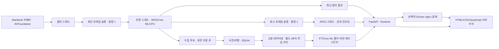

# M1 Pro MacBook · YOLOv8 서버 최종 아키텍처

갱신: 2026-11-06. 현재 코드는 실시간 탐지와 사용자 물체 학습을 구현한다. 실행 명령은 [README](../README.md), 학습 상세 설계는 [수집·학습·버전 관리](custom-object-training-proposal.md), 실측은 [기존 비교 보고서](validation-report.md)와 [학습 기능 검증](custom-object-training-validation.md)에 있다.

## 구성

macOS 네이티브 arm64 Python 3.11을 conda/mamba로 실행한다. 추론 `.conda/mps`, 변환/추론 `.conda/coreml`, 학습 `.conda/train`을 분리한다. Docker Desktop의 Linux VM에는 카메라·MPS·Core ML을 넣지 않는다. 컨테이너는 HTTP/MJPEG/WebSocket 중계만 담당한다.

기본 주소는 `127.0.0.1:8000`, Docker 중계는 `127.0.0.1:8080`이다. Uvicorn worker는 1개다. 학습 외 동작은 단일 프로세스 내 캡처·추론·JPEG·수집 저장 스레드로 분리한다. 카메라와 모델은 각각 한 작업자가 소유한다.

## 입력·추론·백엔드

- 기본 입력: 카메라 인덱스 0, 1280×720·30 FPS 요청. 실제 해상도와 관측 FPS를 별도 표시한다.
- 기본 모델: 로컬 YOLOv8n COCO80, 기본 백엔드 MPS. `.env.example`의 값은 자동 로드하지 않으며 export한 환경 변수를 사용한다.
- 추론: 640×640, confidence 0.25, IoU 0.45, max_det 100, rect=False.
- CPU는 명시적 진단 모드이며 오류 시 자동 전환하지 않는다.
- Core ML: FP16, batch 1, 정적 640, NMS를 포함하지 않는 raw 출력. 공통 LetterBox/NMS/scale_boxes로 원본 픽셀 좌표를 반환한다.
- Core ML compute units는 `CPU_AND_NE`. 이 설정은 전체 모델의 Neural Engine 실행을 증명하지 않는다.
- 모델·데이터 다운로드는 준비 스크립트에서 수행한다. 서버는 로컬 모델이 없으면 준비 방법을 오류에 표시한다.

모든 백엔드는 `{class_id, label, confidence, xyxy}`를 반환한다. custom 클래스 개수와 이름은 모델 메타데이터에서 읽는다. 소스와 같은 좌표의 박스를 동일 프레임에 그리며 일반 미리보기는 원본을 변경하지 않는다.

## 지연·상태·전송

미처리 프레임을 새 입력으로 교체하는 용량 1 슬롯을 사용한다. 캡처 프레임마다 단조 증가 frame_id를 부여하고 파이프라인마다 새로운 session_id를 발급한다. 중복 판정은 `(session_id, frame_id)`다.

JPEG는 구독자가 있을 때만 최대 15 FPS로 한 번 인코딩하여 공유한다. 느린 연결에는 대기 프레임을 누적하지 않으며 HTTP/WS 전송당 5초 제한을 적용한다. MJPEG 헤더에 `X-Session-Id`, `X-Frame-Id`, `X-Model-Version`을 넣는다.

첫 결과 전까지 HTTP 상태 화면은 제공하되 readiness는 비활성화한다. 카메라는 1·2·4·8초, 이후 최대 10초 간격으로 재연결한다. 결과가 1초 이상 오래되면 stale이다. 카메라 재연결의 generation이 바뀌면 이전 세대 결과를 준비 상태로 취급하지 않는다.

주요 상태는 `starting`, `ready`, `camera_unavailable`, `stale`, `error`, `camera_off`, `switching_model`, `training`, `stopped`다. 수집 상태와 작업 단계는 별도 필드다. 추론·카메라 오류는 API와 UI에 표시한다. 객체가 없으면 빈 목록으로 갱신한다.

| 경로 | 역할 |
| --- | --- |
| `/`, `/static/*` | 빌드 없이 제공하는 한국어 UI |
| `/healthz` | API 프로세스 liveness |
| `/readyz` | 모델·카메라·최신 결과 준비 여부, 미준비 503 |
| `/api/status` | 모델 버전·백엔드·카메라·FPS·지연·드롭·오류·수집 상태 |
| `/api/detections/latest` | 원본 좌표의 최신 탐지, 미준비/stale 503 |
| `/stream.mjpg` | 동일 프레임에 박스를 그린 MJPEG |
| `/ws/detections` | 탐지 결과·상태 |
| `/ws/events` | 수집·학습·버전 적용의 최신 snapshot |

서버 지연은 캡처 read 반환 시점부터 탐지 결과 게시까지다. 센서 내부 대기, 네트워크와 브라우저 표시 지연은 포함하지 않는다.

## 수집·학습·버전

서버 시작 시 카메라 자동 시작을 유지한다. 사진 저장은 명시적으로 시작하며 중앙의 후보 하나가 3개 처리 프레임에서 연속 확인된 후 수행한다. 원본과 박스를 함께 저장하고 SQLite에 완료·검토 상태를 기록한다. 수집 heartbeat가 10초 동안 없으면 **저장만 중지**한다.

승인 자료를 환경 그룹과 근접 중복 연결 요소로 나누고 immutable dataset을 생성한다. 실제 학습은 폴더 검색 대신 고정된 train.txt/val.txt 이미지 목록을 사용한다. 학습·평가·변환 중 실시간 파이프라인은 해제한다. 완료 후 이전 모델로 탐지를 재개하되 카메라 끄기·서버 종료 요청이 있었으면 재개하지 않는다.

학습은 소유한 자식 프로세스에서 실행하고 부모 EOF 감시, 취소 시 프로세스 그룹 종료, 재시작 시 interrupted 복구를 제공한다. 모델 적용은 기존 파이프라인 종료→새 모델 로드·워밍업→전환 확정 순서다. 실패하면 이전 모델을 복구한다. 신규 버전은 자동 적용하지 않는다.

원본 COCO80과 사용자 전용 모델을 따로 관리한다. PT 기술 검증과 사용자 validation 평가 후 Core ML을 변환한다. Core ML 정확도 감소가 1%p를 넘거나 기술 검증에 실패하면 해당 형식은 비활성화한다. PT가 검증되었다면 변환 실패 후에도 사용할 수 있다.

## 운영·검증

`bash scripts/stack.sh up mps|coreml`은 Docker와 네이티브 서버를 함께 관리한다. 중계 중지 감지 시 서버를 종료한다. `stack.sh down` 또는 `stop.sh`는 확인된 서버와 그 서버가 소유한 학습/변환 자식까지 정리한다. 별도로 실행한 Mac 서버는 단순 `docker compose down`만으로 종료되지 않는다.

프로젝트 기본 `state/`, `data/`, `models/`, `artifacts/`, `.conda/`는 Git 제외다. 사용자 데이터는 외부 업로드하지 않는다. 외부 공개, 영상 녹화, 자동 시작 서비스, Swift 앱, 수동 박스 편집은 현재 범위에 포함하지 않는다.

자동 회귀 검사는 카메라·모델을 대체하여 수행한다. 실제 카메라 관측, MPS 학습, Core ML 변환, 브라우저 버전 전환은 별도 실장비 검증으로 보고한다. 장시간 지속 성능 및 사용자 물체 정확도는 짧은 기능 검사와 구분한다.
