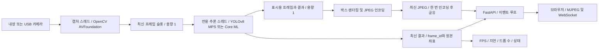

# M1 Pro MacBook의 YOLOv8 실시간 객체 탐지 아키텍처 및 구현 방안

작성일: 2026-11-05 · 대상: macOS / Apple Silicon M1 Pro / 카메라 1대 / YOLOv8 Detect

## 1. 권장 구현 방향

**macOS에서 Python을 네이티브로 실행하고, OpenCV로 카메라 프레임을 받아 YOLOv8n을 PyTorch MPS로 추론하는 구성을 먼저 구축한다. 이후 FastAPI로 영상과 탐지 결과를 제공하고, 측정 결과에 따라 Core ML로 추론 엔진을 교체한다.**

초기 구성은 다음과 같다.

- 입력: MacBook 내장 카메라 또는 Mac에 연결한 USB 카메라 1대.
- 추론: `yolov8n.pt`, `imgsz=640`, 단일 프레임 처리, MPS 사용.
- 실행: 하나의 Python 프로세스 안에서 캡처, 추론, 출력 작업을 분리.
- 지연 제어: 처리하지 못한 과거 프레임을 버리고 최신 프레임만 유지.
- 로컬 확인: OpenCV 창에 바운딩 박스 표시.
- 서빙: FastAPI + Uvicorn으로 MJPEG 영상과 WebSocket 탐지 메타데이터 제공.
- 최적화: 같은 YOLOv8 가중치를 Core ML로 변환해 지연·정확도·지속 성능을 비교.

이 구성은 본 프로젝트를 위한 설계 제안이다. 아래 성능 목표는 M1 Pro에서 실측한 결과가 아니다. 이번 산출물은 설계 문서이며, 예제 코드 실행, 패키지 설치, 모델 다운로드, 카메라 접근 및 성능 측정은 수행하지 않았다.

## 2. 범위, 가정 및 현재 상태

| 항목 | 기준 |
| --- | --- |
| 프로젝트 경로 | `/Users/ryankim/Documents/robotics/yolov8` |
| 확인한 작업 폴더 | 작성 전에는 빈 `docs` 디렉터리만 존재하며, 구현 코드와 의존성 정의가 없음 |
| 현재 명령 실행 환경 | `arm64`, macOS `27.0`, 기본 `python3`는 `3.9.6` |
| 대상 장비 | 사용자 지정 M1 Pro MacBook. 메모리 용량·GPU 코어 수·카메라 종류는 미확인 |
| 권장 Python | 별도 설치한 arm64 Python 3.11 또는 3.12로 가상환경 생성. 아래 예시는 3.11 사용 |
| 기본 서비스 범위 | 같은 Mac의 브라우저에서 접속하는 로컬 서비스 |
| 탐지 대상 | 우선 COCO 사전 학습 모델의 80개 클래스. 전용 부품 등은 별도 데이터셋과 학습 필요 |
| 영상 저장 | 기본 비활성화. 실시간 처리와 결과 표시부터 구현 |

YOLOv8의 객체 탐지 모델은 `yolov8n.pt`, `yolov8s.pt` 등이다. 여기서는 요청한 YOLOv8을 사용하며, 라이브러리의 최신 예제에 나오는 다른 모델 이름으로 바꾸지 않는다. 사전 학습 클래스와 모델 종류는 [Ultralytics YOLOv8 공식 문서](https://docs.ultralytics.com/models/yolov8/)에서 확인할 수 있다.

## 3. 초기 설정과 성능 목표

### 3.1 시작 설정

| 항목 | 시작값 | 조정 기준 |
| --- | --- | --- |
| 모델 | `yolov8n.pt` | 탐지 품질이 부족하고 지연 여유가 있으면 `yolov8s.pt` 비교 |
| 카메라 입력 | 1280×720, 30 FPS 요청 | 실제 지원 모드와 관측 FPS를 확인하고 필요 시 640×480 비교 |
| 추론 입력 | 640×640, `rect=False` | 512 또는 416으로 줄여 정확도와 지연 비교 |
| 배치 | 1 | 단일 카메라의 응답 지연을 우선 |
| Confidence | 0.25 | 검증 영상에서 오탐·미탐을 보고 조정 |
| NMS IoU | 0.45 | 겹친 물체와 중복 박스 사례로 조정 |
| 최대 탐지 수 | 100 | 실제 장면의 물체 수에 맞춤 |
| 미처리 입력 슬롯 | 1개 | 새 프레임이 들어오면 미처리 프레임 교체 |
| 초기 미리보기 | 10~15 FPS | 추론 FPS와 독립적으로 조절 |
| API worker | 1 | 카메라 및 모델 소유권을 한 프로세스에 유지 |

카메라 해상도와 모델 입력 해상도는 별개다. 1280×720 프레임을 640×640에 맞출 때 종횡비를 보존하고 여백을 넣는 letterbox 전처리를 적용한다. `rect=False`는 PyTorch와 정적 크기 Core ML 모델의 비교 조건을 맞추기 위한 선택이다. Ultralytics의 입력 형식, `rect`, 임계값 및 스트림 옵션은 [Predict 문서](https://docs.ultralytics.com/modes/predict/)를 따른다.

### 3.2 검증할 목표

- 1차 목표: 서로 다른 프레임에 대한 탐지 결과를 초당 15회 이상 생성.
- 개선 목표: 장비와 모델 조건이 허용하면 탐지 결과를 초당 30회 생성.
- 서버 내부 지연 목표: 프레임을 애플리케이션이 읽은 시점부터 결과 게시까지 p95 150 ms 이하.
- 브라우저 표시 지연 목표: 실제 장면 변화부터 표시까지 p95 250 ms 이하. 별도 측정 필요.
- 안정성 목표: 30분 연속 실행 중 큐 길이와 메모리가 계속 증가하지 않을 것.

30 FPS의 프레임 간격은 약 33.3 ms, 15 FPS는 약 66.7 ms다. 모든 입력 프레임을 처리하려면 해당 간격 안에 처리할 수 있어야 한다. 처리량이 부족한 경우 프레임을 생략해 최신성을 유지한다. 다른 칩이나 다른 YOLO 모델의 공개 벤치마크를 M1 Pro의 보장 성능으로 사용하지 않는다.

## 4. 추론 엔진 선택

| 방식 | 장점 | 확인할 점 | 도입 시점 |
| --- | --- | --- | --- |
| PyTorch CPU | 기능과 출력 비교가 간단 | 목표 FPS를 충족하는지 측정 필요 | 장애 진단 및 기준 결과 생성 |
| PyTorch MPS | `.pt`를 바로 사용, Python 개발이 간단 | 연산 지원, GPU 메모리, 전·후처리 비용 | 1차 기본 구현 |
| Core ML + Python | 기존 서버 구조를 유지하면서 엔진 교체 가능 | 변환 호환성, 전처리·NMS 일치, 실제 연산 배치 | 성능 비교 후 채택 |
| Core ML + Swift/Vision/AVFoundation | 네이티브 캡처와 표시를 통합 가능 | macOS 앱 구현·배포 비용 | 장기 실행 앱 또는 추가 최적화 필요 시 |

PyTorch의 `mps`는 Metal 기반 GPU 실행 경로다. MPS 사용 가능 여부는 `torch.backends.mps.is_available()`로 확인한다. 이를 Apple Neural Engine 사용으로 해석하지 않는다. [PyTorch MPS 문서](https://docs.pytorch.org/docs/stable/notes/mps.html)

Core ML은 설정과 지원 연산에 따라 CPU, GPU, Neural Engine을 사용할 수 있다. `all`은 사용 가능한 장치를 허용하는 설정이고, `cpuAndNeuralEngine`은 CPU와 Neural Engine을 허용한다. 특정 설정이 모델 전체의 Neural Engine 실행을 보장하지는 않는다. [Apple MLComputeUnits](https://developer.apple.com/documentation/coreml/mlcomputeunits)

초기 카메라·추론 프로세스는 macOS 호스트에서 직접 실행한다. CUDA/TensorRT를 사용하는 NVIDIA 배포 구성을 이 장비에 적용하지 않는다. Docker나 별도 모델 서버를 먼저 추가하기보다, 단일 프로세스에서 병목을 확인한 뒤 필요할 때 API와 추론 프로세스를 분리한다.

## 5. 권장 아키텍처



Mermaid를 지원하지 않는 뷰어에서는 `카메라 → 최신 프레임 → 단일 추론 → 최신 결과 → 화면/API` 흐름으로 읽으면 된다.

### 5.1 역할과 소유권

| 구성 요소 | 책임 | 구현 규칙 |
| --- | --- | --- |
| 캡처 스레드 | 카메라 열기·읽기·재연결·해제 | 카메라는 이 스레드만 조작 |
| 입력 슬롯 | 가장 최근의 미처리 프레임 보관 | 잠금으로 교체와 읽기를 원자적으로 수행 |
| 추론 스레드 | 모델 로드·워밍업·예측·후처리 | 모델 인스턴스를 독점하며 호출을 직렬화 |
| 결과 저장소 | 최신 탐지 결과와 상태 보관 | 짧은 잠금으로 불변 스냅샷 교체 |
| 인코딩 스레드 | 같은 프레임에 박스를 그려 JPEG 생성 | 구독자가 있을 때만 제한된 FPS로 동작 |
| FastAPI 이벤트 루프 | HTTP 및 WebSocket 연결 처리 | 캡처·추론·JPEG 인코딩을 직접 수행하지 않음 |

모델을 매 요청마다 다시 로드하지 않는다. 여러 API 요청이 동일 모델을 동시에 호출하게 하지 않고, 하나의 추론 작업자가 모든 예측을 담당한다. 이 소유권 설계는 Ultralytics가 설명하는 공유 모델의 동시 호출 문제를 피하기 위한 것이다. [Ultralytics 스레드 안전 가이드](https://docs.ultralytics.com/guides/yolo-thread-safe-inference/)

### 5.2 최신 프레임 처리 규칙

아래는 동작을 정의하기 위한 의사코드이며, 완성된 Python 코드는 아니다.

```text
capture_loop:
    카메라에서 frame 읽기
    frame_id 증가, captured_monotonic_ns 기록
    lock 안에서:
        미처리 프레임이 있으면 input_dropped 증가
        input_slot을 새 FramePacket으로 교체
        condition 알림

inference_loop:
    condition으로 새 입력 또는 종료 신호 대기
    lock 안에서 input_slot을 가져오고 비움
    lock 밖에서 전처리 → 추론 → NMS → 원본 좌표 복원
    같은 frame_id의 결과 스냅샷 게시
    같은 원본 frame과 결과를 preview_slot에 게시
    다음 실행 시 그동안 도착한 가장 최근 프레임 사용
```

- `queue.Queue(maxsize=1)`를 쓰더라도 가득 찼을 때 단순히 새 프레임을 버리면 과거 프레임이 남는다. 기존 미처리 항목을 교체하는 정책을 구현한다.
- 잠금을 잡은 상태에서 카메라 읽기, 추론 또는 인코딩을 하지 않는다.
- 게시한 NumPy 프레임을 캡처 작업자가 다시 수정하지 않도록 소유권을 넘기거나 필요한 경계에서 복사한다.
- `frame_id`가 같으면 다시 추론하거나 동일한 결과를 새 탐지 결과로 집계하지 않는다.
- 영상과 박스는 반드시 같은 `frame_id`로 묶는다. 최신 원본 영상에 과거 탐지 박스를 무조건 덧그리지 않는다.
- 결과와 영상은 구독자별 최신 슬롯으로 전달한다. 느린 브라우저 때문에 추론 작업자가 대기하지 않게 한다.
- 전송 중인 과거 데이터는 슬롯 교체만으로 취소되지 않는다. 전송 제한 시간과 연결 종료 정책도 둔다.

OpenCV의 버퍼 크기·FPS·해상도 속성은 드라이버와 백엔드에 따라 다르게 동작한다. `CAP_PROP_BUFFERSIZE=1`만으로 지연 문제가 해결된다고 가정하지 않는다. [OpenCV Video I/O 속성](https://docs.opencv.org/4.x/d4/d15/group__videoio__flags__base.html)

## 6. 개발 환경 준비

아래 명령은 구현 착수 시 실행할 예시다. 현재 기본 `python3`는 3.9.6이므로 먼저 별도 arm64 Python 3.11을 준비하고 `python3.11` 명령이 존재하는지 확인한다. Python 3.12를 선택했다면 명령의 버전을 일관되게 바꾼다.

```bash
cd /Users/ryankim/Documents/robotics/yolov8
python3.11 -m venv .venv
source .venv/bin/activate
python -m pip install --upgrade pip
python -m pip install torch torchvision ultralytics opencv-python fastapi 'uvicorn[standard]'
python -m pip check
mkdir -p models scripts
```

이 설치는 호환 조합을 찾는 초기 절차다. 설치 성공만으로 실행 호환성이 검증되는 것은 아니다. MPS 예측과 카메라 동작을 확인한 조합을 아래처럼 기록하고, 이후에는 그 파일로 재설치한다. PyTorch 설치 시에는 [공식 설치 안내](https://pytorch.org/get-started/locally/)의 macOS 지원 조건을 함께 확인한다.

```bash
python -m pip freeze > requirements-mps.lock.txt
python -m pip install -r requirements-mps.lock.txt
```

OpenCV 창을 사용하는 개발 환경에는 `opencv-python`을 사용한다. 동일 가상환경에 `opencv-python-headless` 등 여러 OpenCV wheel을 함께 설치하지 않는다. 서버 전용 환경 구성은 로컬 화면 검증을 마친 뒤 분리한다.

### 6.1 장치 확인

```bash
python - <<'PY'
import platform
import torch

print("Python:", platform.python_version())
print("Architecture:", platform.machine())
print("PyTorch:", torch.__version__)
print("MPS build:", torch.backends.mps.is_built())
print("MPS available:", torch.backends.mps.is_available())
PY
```

`arm64`와 `MPS available: True`를 확인한다. `False`이면 Rosetta 실행 여부, Python/PyTorch 배포판, 설치한 PyTorch의 macOS 요구 사항을 점검한다. CPU로 실행했다면 상태와 측정 기록에 `cpu`를 명확히 남긴다.

MPS 미지원 연산을 조사할 때는 PyTorch import 전에 `PYTORCH_ENABLE_MPS_FALLBACK=1`을 설정해 지원되는 CPU fallback 경로를 시험할 수 있다. 모든 오류가 해결되는 옵션은 아니며, 혼합 실행의 지연도 다시 측정해야 한다. [PyTorch MPS 환경 변수](https://docs.pytorch.org/docs/stable/mps_environment_variables.html)

### 6.2 카메라 권한

처음 카메라를 열면 macOS 권한 요청에 응답하고, 필요하면 **시스템 설정 → 개인정보 보호 및 보안 → 카메라**에서 실제 실행에 사용하는 앱의 접근을 확인한다. 예를 들어 터미널이나 IDE에서 실행하면 그 실행 경로에 맞는 앱 권한을 확인해야 한다. [Apple 카메라 접근 설정](https://support.apple.com/guide/mac-help/control-access-to-your-camera-mchlf6d108da/mac)

카메라 인덱스 `0`이 항상 원하는 장치를 가리키지는 않는다. 내장·USB·연속성 카메라가 함께 있으면 인덱스를 확인한다. `CAP_AVFOUNDATION`을 명시해 macOS 백엔드로 열고, `isOpened()`, `read()`, 실제 `frame.shape`를 확인한다. 해상도와 FPS 설정은 요청값이므로 실제 입력과 구분해 기록한다.

## 7. 1단계: 카메라와 MPS 기능 확인

다음 예제를 `scripts/camera_demo.py`로 저장하면 로컬 화면 검증의 출발점으로 사용할 수 있다. **이 예제는 기능 확인을 위한 동기식 루프다. 5절의 캡처 분리·최신 프레임 처리·API 서빙은 2단계에서 구현한다.**

최초 `YOLO(...)` 실행에서 모델 파일이 없으면 다운로드가 필요할 수 있다. 운영 시에는 검증한 가중치를 `models`에 미리 배치한다.

```python
import time

import cv2
import numpy as np
import torch
from ultralytics import YOLO


def main():
    device = "mps" if torch.backends.mps.is_available() else "cpu"
    print(f"Inference device: {device}")
    if device == "cpu":
        print("CPU diagnostic run: do not record this as an MPS benchmark.")

    detector = YOLO("models/yolov8n.pt")
    options = dict(
        device=device,
        imgsz=640,
        rect=False,
        conf=0.25,
        iou=0.45,
        max_det=100,
        verbose=False,
    )

    # 기능 확인용 워밍업. 성능 측정에서는 더 긴 워밍업을 사용한다.
    for _ in range(3):
        detector.predict(np.zeros((720, 1280, 3), dtype=np.uint8), **options)
    if device == "mps":
        torch.mps.synchronize()

    camera = cv2.VideoCapture(0, cv2.CAP_AVFOUNDATION)
    try:
        if not camera.isOpened():
            raise RuntimeError("카메라 인덱스와 macOS 카메라 권한을 확인하세요.")

        camera.set(cv2.CAP_PROP_FRAME_WIDTH, 1280)
        camera.set(cv2.CAP_PROP_FRAME_HEIGHT, 720)
        camera.set(cv2.CAP_PROP_FPS, 30)
        print("Press q in the preview window to stop.")

        while True:
            ok, frame = camera.read()
            if not ok:
                raise RuntimeError("카메라 프레임을 읽지 못했습니다.")

            started_ns = time.perf_counter_ns()
            result = detector.predict(frame, **options)[0]
            if device == "mps":
                torch.mps.synchronize()
            predict_ms = (time.perf_counter_ns() - started_ns) / 1_000_000

            annotated = result.plot()
            cv2.putText(
                annotated,
                f"{device} predict={predict_ms:.1f} ms",
                (15, 30),
                cv2.FONT_HERSHEY_SIMPLEX,
                0.7,
                (0, 255, 0),
                2,
            )
            cv2.imshow("YOLOv8 camera check", annotated)
            if cv2.waitKey(1) & 0xFF == ord("q"):
                break
    finally:
        camera.release()
        cv2.destroyAllWindows()


if __name__ == "__main__":
    main()
```

```bash
python scripts/camera_demo.py
```

OpenCV에서 받은 BGR NumPy 배열을 Ultralytics에 그대로 전달한다. 예제의 `predict_ms`에는 전처리·추론·후처리가 포함되지만 카메라 지연, 박스 렌더링, 화면 표시 시간은 포함되지 않는다. 이 수치의 역수를 전체 시스템 FPS로 보고하지 않는다.

완료 기준은 카메라 표시, 원하는 객체의 박스 확인, 실제 사용 장치 확인, `q` 종료 후 카메라 해제다. 별도로 Ultralytics 내장 카메라 로더를 사용할 경우 `stream=True`는 결과를 순차 생성하고 `stream_buffer=False`는 오래된 입력을 쌓지 않는 옵션이다. 이를 5절의 직접 구현한 캡처 루프와 중복 사용하지 않는다.

## 8. 2단계: 서비스 구현

### 8.1 권장 디렉터리

아래 구조는 후속 구현 계획이며, 현재 생성된 실행 파일 목록이 아니다.

```text
yolov8/
├── app/
│   ├── __init__.py
│   ├── main.py                 # FastAPI, lifespan, 라우트
│   ├── config.py               # 시작 설정 및 검증
│   ├── capture.py              # 카메라 소유권, 재연결
│   ├── pipeline.py             # 스레드, 최신 슬롯, 종료 제어
│   ├── detector.py             # MPS / Core ML 공통 인터페이스
│   ├── render.py               # 박스 그리기, JPEG 인코딩
│   ├── schemas.py              # FramePacket, DetectionPacket
│   ├── metrics.py              # 카운터 및 제한된 지연 통계
│   └── static/index.html       # 미리보기, 상태, 탐지 목록
├── models/
│   ├── yolov8n.pt
│   └── manifest.json           # 해시, 클래스, 변환·검증 설정
├── scripts/
│   ├── camera_demo.py
│   ├── export_coreml.py
│   └── benchmark.py
├── tests/                     # 슬롯 정책, 좌표, 장애·종료 검증
├── requirements-mps.lock.txt
├── requirements-coreml.lock.txt
└── docs/
    └── yolov8-m1-pro-realtime-detection-architecture.md
```

`detector.py`는 `load → warmup → predict → close` 인터페이스를 제공한다. `predict(frame)`은 엔진과 무관하게 원본 이미지 기준의 `xyxy`, 클래스 ID, 이름, confidence를 반환한다. MPS tensor를 API에 직접 넘기지 말고 CPU의 숫자·리스트로 변환한다.

### 8.2 시작과 종료

FastAPI의 `lifespan`에서 파이프라인을 시작하고 종료한다. 무거운 모델 초기화와 추론은 전용 작업자에서 실행하며, 이벤트 루프는 준비 상태를 비동기로 기다리거나 상태를 제공한다. FastAPI의 공식 권장 수명주기 인터페이스는 [Lifespan Events](https://fastapi.tiangolo.com/advanced/events/)를 참고한다.

1. 설정 검증 및 카메라·모델 작업자 생성.
2. 추론 작업자가 모델 로드와 워밍업 수행.
3. 첫 유효 결과를 받으면 readiness 활성화.
4. 실행 중 카메라·추론·인코딩 작업자의 생존과 마지막 결과 시각 확인.
5. 종료 요청 시 readiness 해제, 종료 이벤트 설정, 대기 중인 condition 깨우기.
6. 연결 정리, 각 소유 작업자의 자원 해제, 제한 시간 내 join 수행.

카메라 `read()` 또는 네이티브 추론이 무기한 멈추면 Python 스레드만으로 강제 종료하기 어렵다. 이런 장애가 실제로 발생하면 캡처·추론을 별도 프로세스로 옮기고 감독 프로세스에서 재시작하는 구조로 확장한다.

서버 구현 후 실행 예시는 다음과 같다.

```bash
python -m uvicorn app.main:app --host 127.0.0.1 --port 8000 --workers 1
```

프로세스별로 카메라와 모델을 생성하는 이 설계에서는 worker 수를 늘리지 않는다. `--reload`는 개발 편의 옵션이지만 장시간 카메라 운용에는 사용하지 않는다. 브라우저가 여러 개 연결되어도 모델 추론은 한 번 수행하고 결과를 공유한다.

### 8.3 API 계약

| 경로 | 형태 | 동작 |
| --- | --- | --- |
| `/` | HTTP GET | 미리보기와 상태 화면 |
| `/healthz` | HTTP GET | API 프로세스 응답 여부, 추론 준비와 별도 |
| `/readyz` | HTTP GET | 모델·카메라 준비 및 결과 최신성 확인. 준비 전·장애·오래된 결과는 503 |
| `/api/status` | HTTP GET | 장치, 모델, 입력 크기, FPS, 드롭 수, 마지막 오류 |
| `/api/detections/latest` | HTTP GET | 최신 결과 반환. 최초 결과 전 또는 stale이면 503과 원인 반환 |
| `/stream.mjpg` | HTTP GET | `multipart/x-mixed-replace; boundary=frame`로 박스가 포함된 JPEG 전송 |
| `/ws/detections` | WebSocket | 새 탐지 결과 JSON 전송, 장애 시 별도 상태 이벤트 |

MJPEG의 각 파트는 `--frame`, `Content-Type: image/jpeg`, 빈 줄, JPEG bytes 순서로 구성한다. JPEG를 구독자 수만큼 다시 인코딩하지 않는다. WebSocket 연결의 종료 처리는 [FastAPI WebSockets 문서](https://fastapi.tiangolo.com/advanced/websockets/)를 따른다.

브라우저는 MJPEG에 이미 그려진 박스를 표시하고, WebSocket은 객체 목록과 통계 갱신에 사용한다. 두 연결의 메시지 도착 시점이 같다고 가정해 별도 박스를 영상 위에 덧씌우지 않는다. 정확한 클라이언트 오버레이가 필요하면 영상과 메타데이터를 같은 `frame_id`로 묶는 프로토콜을 설계한다. 원격 저지연 영상이 핵심 요구가 되면 WebRTC를 별도 단계에서 검토한다.

원격 브라우저에서 접속하더라도 이 서버가 여는 것은 **서버 Mac에 연결된 카메라**다. 접속한 기기의 카메라를 쓰려면 브라우저 캡처와 영상 업로드/WebRTC 수신 경로를 추가해야 한다.

### 8.4 탐지 메시지 예시

아래 숫자는 API 형식을 설명하기 위한 가상 값이며 측정 결과가 아니다.

```json
{
  "schema_version": 1,
  "event": "detections",
  "session_id": "run-example-001",
  "frame_id": 1842,
  "captured_at": "2026-11-05T14:00:00.123Z",
  "source_size": {"width": 1280, "height": 720},
  "model": "yolov8n",
  "backend": "pytorch-mps",
  "timing_ms": {
    "queue_wait": 3.1,
    "predict": 41.2,
    "capture_to_result": 45.0
  },
  "objects": [
    {
      "class_id": 0,
      "label": "person",
      "confidence": 0.92,
      "xyxy": [120.0, 80.0, 430.0, 650.0]
    }
  ]
}
```

- 좌표는 원본 프레임의 좌상단을 `(0, 0)`으로 하는 픽셀 단위이며, 순서는 `[x1, y1, x2, y2]`다.
- 탐지 물체가 없으면 `objects: []`를 전송한다. 이전 물체를 계속 표시하지 않는다.
- 클래스 이름은 해당 모델의 메타데이터에서 읽는다. 사용자 학습 모델에도 COCO 이름을 강제로 적용하지 않는다.
- 서비스 재시작 후 `frame_id`가 다시 시작될 수 있으므로 `session_id`와 함께 식별한다.
- `captured_at`은 로그 상관관계용 UTC 시각이다. 지연 계산에는 같은 프로세스의 단조 증가 시계를 사용한다.
- OpenCV `read()` 직후의 시간은 애플리케이션 수신 시각이다. 센서 노출 시각이나 드라이버 내부 대기시간까지 측정한 것으로 표현하지 않는다.

## 9. 3단계: Core ML 비교 및 전환

### 9.1 변환 환경과 예제

MPS 환경을 보존하고 별도 가상환경에서 변환을 검증한다. Ultralytics, PyTorch, coremltools의 조합을 함께 고정하며, 변환기의 미검증 PyTorch 버전 경고를 확인한다. 설치 안내 페이지와 최신 릴리스의 지원 범위가 다를 수 있으므로 실제 선택한 버전 기준으로 검증한다. [Apple coremltools 설치 안내](https://apple.github.io/coremltools/docs-guides/source/installing-coremltools.html)

```bash
python3.11 -m venv .venv-coreml
source .venv-coreml/bin/activate
python -m pip install --upgrade pip
python -m pip install ultralytics coremltools
python -m pip check
```

다음은 `scripts/export_coreml.py`에 사용할 변환 예제다. 작성일 기준 공식 문서의 `quantize=16` 옵션을 사용한다. 구버전 예제의 `half` 또는 `int8` 옵션과 혼용하지 말고 설치한 Ultralytics 버전의 API를 확인한다.

```python
from ultralytics import YOLO


def main():
    detector = YOLO("models/yolov8n.pt")
    artifact_path = detector.export(
        format="coreml",
        imgsz=640,
        batch=1,
        dynamic=False,
        nms=True,
        conf=0.25,
        iou=0.45,
        quantize=16,
        device="cpu",
    )
    print(f"Exported artifact: {artifact_path}")


if __name__ == "__main__":
    main()
```

```bash
python scripts/export_coreml.py
python -m pip freeze > requirements-coreml.lock.txt
```

공식 Core ML 통합 문서에는 YOLOv8 Detect 지원이 명시되어 있으며, 정적 입력·NMS 포함 변환과 macOS에서의 예측 경로를 제공한다. [Ultralytics Core ML 문서](https://docs.ultralytics.com/integrations/coreml/)

### 9.2 교체 시 확인할 항목

1. export가 반환한 실제 `.mlpackage` 경로를 `YOLO(...)`로 로드하고 동일한 저장 이미지로 예측한다. Core ML 실행에 PyTorch의 `device="mps"` 설정을 그대로 전달하지 않는다.
2. 입력 크기, RGB/BGR 처리, 정규화, letterbox, 클래스 순서, 박스 좌표 복원을 확인한다. 라이브러리 경로와 직접 Core ML 호출 경로에서 전처리를 중복하지 않는다.
3. `nms=True` 모델에는 NMS가 포함된다. 후처리에서 다시 적용하지 않고, confidence·IoU가 export 시 고정되는지 또는 입력으로 노출되는지 실제 모델 명세를 확인한다. 낮은 confidence 결과가 이미 제거되었다면 외부 후처리만으로 복원할 수 없다.
4. raw 출력으로 변환할 경우 설치 버전이 제공하는 raw 출력 옵션을 확인하고 별도의 decode·NMS를 구현한다. YOLOv8에 다른 모델 계열의 NMS-free 출력 구조를 적용하지 않는다. 출력 이름·shape를 하드코딩하기 전에 모델 명세를 검사한다.
5. Python 로더의 compute units 정책을 확인한다. 작성일의 Ultralytics 문서는 일반 Core ML 로딩에 `CPU_AND_NE`를 사용한다고 설명하지만, 고정한 패키지 버전의 실제 설정을 기록해야 한다.
6. 고정 영상에서 탐지 품질과 지연을 비교하고, 채택한 가중치·export 옵션·의존성 버전·파일 해시를 `manifest.json`에 보관한다.

위 변환 옵션과 로더 정책의 근거는 [Core ML export 및 실행 설정](https://docs.ultralytics.com/integrations/coreml/)과 [모델 export 인자](https://docs.ultralytics.com/modes/export/)다. `device="cpu"`는 여기서 변환 작업의 장치이며, 변환된 모델을 실행할 장치를 CPU로 고정하는 설정이 아니다.

Core ML로 바꿔도 Python의 프레임 복사, 후처리, JPEG 인코딩 비용은 남는다. 전체 파이프라인이 더 빨라지는지 측정한 뒤 전환한다. 추가 압축은 FP16 결과를 검증한 다음 별도 실험으로 진행한다.

### 9.3 네이티브 macOS 앱이 필요한 경우

Swift 앱으로 전환할 때는 `AVCaptureSession → AVCaptureVideoDataOutput → Vision/Core ML → 화면 오버레이`로 구성한다. 영상 콜백에서 긴 작업을 하지 않고 직렬 추론 큐를 사용하며, 원본 방향·미러링·화면 확대 방식에 맞춰 좌표를 변환한다.

`alwaysDiscardsLateVideoFrames`를 사용해 늦어진 프레임을 버리는 정책은 Apple의 [AVCaptureVideoDataOutput 프레임 드롭 가이드](https://developer.apple.com/library/archive/technotes/tn2445/_index.html)를 따른다. API 서빙이 계속 필요하면 앱의 탐지 결과를 제공하는 계층도 유지해야 한다.

## 10. 성능 측정과 개선 순서

### 10.1 측정 절차

1. 모델·입력 크기·임계값을 고정하고 저장 영상으로 결과를 비교한다. 처리량 비교용 영상 재생은 같은 프레임 집합을 사용한다.
2. 초기 로드·컴파일은 별도로 측정하고, 약 50회 워밍업 후 최소 1,000프레임의 지연 분포를 기록한다. 필요하면 워밍업을 늘린다.
3. 카메라 실행에서는 실제 입력 FPS, 처리 FPS, 표시 FPS와 프레임 생략 수를 각각 기록한다.
4. 브라우저 0개·1개·복수 연결에서 측정해 인코딩과 전송 비용을 분리한다.
5. 전원 연결, 저전력 모드, 다른 앱 부하, macOS·Python·라이브러리 버전 및 모델 해시를 기록한다.
6. 30분 연속 실행으로 초기 5분과 마지막 5분의 p50/p95 지연·FPS·메모리를 비교한다.

| 지표 | 정의 |
| --- | --- |
| Capture FPS | `read()`에 성공한 서로 다른 프레임 수 / 관측 시간 |
| Detection FPS | 예측을 완료한 서로 다른 `frame_id` 수 / 관측 시간 |
| Preview FPS | 실제 인코딩 또는 표시한 서로 다른 프레임 수 / 관측 시간 |
| Input dropped | 추론이 소비하기 전에 새 입력으로 교체된 프레임 수 |
| Queue wait | 애플리케이션 수신부터 추론 시작까지 |
| Predict latency | 전처리·모델 실행·후처리 완료까지. 가능하면 세부 시간도 분리 |
| Capture-to-result | 애플리케이션 수신부터 결과 게시까지 |
| Capture-to-JPEG | 애플리케이션 수신부터 표시용 JPEG 준비까지 |
| Frame age | 현재 시각에서 마지막 결과의 입력 수신 시각을 뺀 값 |

MPS 실행 시간만 독립적으로 측정할 때는 측정 시작 전과 끝에 `torch.mps.synchronize()`를 사용해 비동기 실행이 측정 구간 밖으로 빠지지 않게 한다. 결과를 CPU로 가져오는 비용도 별도로 기록한다. 브라우저와 서버의 서로 다른 시계를 단순히 빼서 전체 지연을 구하지 않는다. 실제 표시 지연은 공통 시각 기준을 마련하거나 장면과 화면을 함께 촬영하는 방식 등으로 측정한다.

지연 통계는 제한된 크기의 순환 버퍼나 히스토그램으로 유지한다. 매 프레임 결과를 무제한 리스트에 누적하지 않는다.

### 10.2 실험 매트릭스

| 모델 | 런타임 | 입력 | Detection FPS | Capture-to-result p95 | 정확도·관찰 |
| --- | --- | --- | --- | --- | --- |
| YOLOv8n | MPS | 640 | 미측정 | 미측정 | 기준 구성 |
| YOLOv8n | MPS | 512 | 미측정 | 미측정 | 작은 객체 누락 비교 |
| YOLOv8n | Core ML FP16 | 640 | 미측정 | 미측정 | 변환 전후 결과 비교 |
| YOLOv8s | MPS | 640 | 미측정 | 미측정 | 정확도 개선 여부 |
| YOLOv8s | Core ML FP16 | 640 | 미측정 | 미측정 | 품질·지연 균형 |

최적화 순서는 다음과 같다.

1. 입력·전송 버퍼가 누적되는지 먼저 제거한다.
2. JPEG 인코딩과 박스 렌더링을 10~15 FPS로 제한하고, 구독자가 없으면 중지한다.
3. `640 → 512 → 416` 순서로 모델 입력 크기를 줄여 작은 객체의 미탐을 평가한다.
4. 같은 조건에서 MPS와 Core ML을 비교한다.
5. 정확도 여유가 필요한 경우 YOLOv8s를 평가한다.
6. Python 프레임 처리·표시가 병목인 경우에만 네이티브 구현을 검토한다.

정확도는 가능한 한 실제 카메라 조건의 라벨링된 검증 영상에서 precision, recall, mAP로 평가한다. 초기 승인 기준 제안은 기준 모델 대비 mAP50-95 감소 1 percentage point 이내와 중요 클래스 recall 비악화다. 라벨이 없다면 수동 점검만 했음을 명시하고 정량 정확도를 주장하지 않는다. 박스가 모델 간 완전히 동일할 필요는 없지만, 일관된 좌표 이동·클래스 오매핑·물체 누락은 조사한다.

## 11. 장애 처리와 운영

| 상황 | 처리 방안 |
| --- | --- |
| 카메라 열기 실패 | 인덱스·권한·연결 상태를 확인하고 준비 상태를 비활성화 |
| 프레임 읽기 실패 | 캡처 소유자가 닫고 1·2·4초 등 상한이 있는 backoff로 재연결 |
| 카메라 입력 중단 | 시작 기준으로 마지막 유효 결과가 1초 이상 오래되면 stale 처리, 화면에 상태 표시 |
| 추론 작업자 예외 | 오류를 상태에 노출하고 readiness 해제. 무한 예외 반복을 막고 명시적 재시작 수행 |
| MPS 미사용·오류 | 장치와 의존성부터 진단. CPU 전환 시 backend와 degraded 상태를 표시 |
| 느린 클라이언트 | 최신 결과만 보관하고 전송 timeout 시 해당 연결 종료 |
| 메모리 증가 | 결과·프레임·JPEG·지표 버퍼의 상한과 참조 해제 확인 |
| 절전 후 복귀 | 이전 결과를 stale로 처리하고 카메라 재열기 및 워밍업 여부 확인 |

stale 기준 1초는 초기 운영 설정이며, 정상 지연 목표 150 ms와는 다른 장애 판정 기준이다. 복구 시 최신 유효 결과를 받은 뒤 readiness를 다시 활성화한다. 영상 연결도 중단 상태를 표시하거나 종료해 마지막 정상 화면을 현재 화면으로 오해하지 않게 한다.

처음에는 사용자 세션의 터미널에서 실행한다. 자동 시작이 필요해지면 사용자 LaunchAgent를 검토하되 카메라 권한과 로그인·절전 복귀 동작을 먼저 검증한다. 기본 바인딩은 `127.0.0.1`로 유지하고, LAN 제공이 요구될 때만 접근 범위와 인증을 추가한다. 운영 로그에는 원본 프레임 대신 모델·설정·지연·오류를 우선 기록한다.

## 12. 단계별 작업과 완료 기준

| 단계 | 구현 작업 | 완료 기준 |
| --- | --- | --- |
| 1. 기능 확인 | arm64 가상환경, MPS 확인, 카메라 예제 | 화면에 객체 박스 표시, 장치 확인, 정상 종료 |
| 2. 실시간 파이프라인 | 캡처·추론 분리, 최신 슬롯, 메트릭 | 인위적으로 추론을 늦춰도 프레임과 메모리가 무한 누적되지 않음 |
| 3. 로컬 서빙 | FastAPI, MJPEG, WebSocket, 상태 API | 브라우저 여러 개가 한 카메라·모델의 결과를 공유, 느린 연결 격리 |
| 4. 최적화 | 입력 크기·MPS/Core ML 비교 | 같은 검증 조건에서 지연·정확도 기준을 만족하는 구성 선정 |
| 5. 안정화 | 카메라 재연결, 예외·종료 처리, 버전 고정 | 30분 실행, 연결 해제·복구, 절전 복귀 및 재시작 검증 |

후속 구현에서는 특히 다음을 자동 또는 수동으로 검증한다.

- 느린 추론 중에도 다음 소비 프레임이 가장 최근 프레임인지 확인.
- letterbox 적용 전후의 원본 좌표 복원, 미러링 및 화면 크기 변환 확인.
- 물체가 없을 때 빈 탐지 결과로 이전 표시가 사라지는지 확인.
- 늦게 연결한 구독자가 과거 이력 대신 최신 결과부터 받는지 확인.
- 복수 구독자와 느린 구독자에서도 모델 로드 횟수와 카메라 연결 수가 1인지 확인.
- 작업자 예외·카메라 분리·종료 시 상태가 바뀌고 자원이 정리되는지 확인.

첫 구현의 채택 기준은 **YOLOv8n + MPS + 최신 프레임 슬롯 + 단일 FastAPI 프로세스**다. Core ML 전환은 동일 조건의 검증에서 실질적인 개선을 확인했을 때 진행한다.
